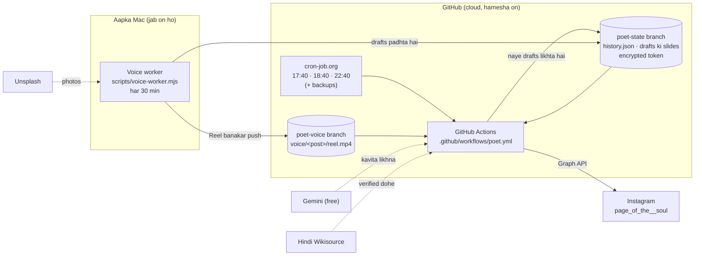

# page_of_the__soul — Hinglish poetry automation

Instagram page **page_of_the__soul** ke liye har din **3 posts** apne aap jaati hain. Har post mein ek nayi Hinglish kavita hoti hai, kabhi-kabhi Kabir ya Rahim ke verified dohe ke saath:

| Waqt (IST) | Kya jaata hai | Kaun banata hai |
|---|---|---|
| **18:00** | 🎬 **Reel**: aapki awaaz mein kavita, asli photos, cinematic effects, halki dhun | Reel **Mac** pehle se banata hai, **GitHub** post karta hai |
| **19:00** | 🖼️ **Carousel post**: 2–3 slides (cover, bhavarth, kavita) | **GitHub** |
| **23:00** | 🎬 **Reel** | Mac banata hai, GitHub post karta hai |

- Agar kisi Reel slot tak Reel taiyaar nahi hai (jaise Mac kai din band raha), toh us waqt **carousel** chala jaata hai. Koi slot khaali nahi jaata.
- Har post **theek time par** jaati hai: post pehle se taiyaar rehti hai, aur publish ka button theek 18:00:00 / 19:00:00 / 23:00:00 par dabta hai.

---

## 1. Poora flow, ek nazar mein



Yahi flow shabdon mein:

1. **Draft (GitHub).** Har slot ke baad GitHub check karta hai ki queue mein 15 drafts hain ya nahi. Kam hon toh Gemini se 3 naye drafts likhwata hai:
   - kavita, caption aur hashtags;
   - zaroorat ho toh Wikisource se verified doha;
   - 1080×1350 ki slides.

   Sab kuch `poet-state` branch par save hota hai.
2. **Reel (Mac).** Mac ka voice worker har 30 minute mein jaagta hai. Aage ke drafts mein se jinki Reel nahi bani, unke liye ye karta hai:
   - kavita ko Devanagari mein badalta hai;
   - aapki awaaz (AI clone) mein page-wise padhta hai;
   - Unsplash se asli photos laata hai;
   - effects aur dhun lagata hai;
   - `reel.mp4` banakar `poet-voice` branch par push kar deta hai.
3. **Post (GitHub).** cron-job.org har slot se ~20 minute pehle GitHub Actions ko chalata hai. GitHub ye karta hai:
   - Reel slot par `poet-voice` mein taiyaar Reel dhoondhta hai;
   - Instagram par container banata hai aur theek slot time par publish karta hai;
   - phir history update karke `poet-state` par save kar deta hai.
4. **Mac band ho toh?** GitHub ko Mac ki zaroorat sirf Reel banane ke liye hai. Pehle se bani ~10 Reels din mein 2 ke hisaab se ~5 din chalti hain. Uske baad Reel slots par carousel jaata hai.

---

## 2. GitHub se Reel kaise post hoti hai (step by step)

Ye sab **GitHub Actions** par chalta hai, Mac ki zaroorat nahi:

1. **17:40 IST:** cron-job.org GitHub ko `workflow_dispatch` bhejta hai (`mode=tick`). Saath mein 18:05 aur 18:30 par backup triggers bhi aate hain.
2. **Workflow ke shuru ke steps** (`.github/workflows/poet.yml`):
   - code checkout aur `npm ci`;
   - `poet-state` branch se `history.json` aur drafts ki slides laana;
   - Instagram token decrypt karna (`token.enc` ko `TOKEN_STATE_KEY` se);
   - `node src/cli.js tick --check`: kya koi slot is waqt due hai? Nahi, toh run 20 second mein khatam.
3. **`node src/cli.js tick`** → `src/job.js → tick()`:
   - `src/slots.js` batata hai ki 18:00 ka slot "run" mein hai, aur iska format `reel` hai.
   - `publishNext({ format: "reel" })`: drafts mein se **sabse purana voiced draft** dhoondhta hai. Iske liye `src/mediaHost.js → createVoiceReels().find()` `poet-voice` branch par `voice/<id>/meta.json` padhta hai, aur check karta hai ki kavita ka text-hash meta se milta hai.
   - Instagram API (`src/instagramPublisher.js → createReel`): `media_type=REELS` aur `video_url=https://raw.githubusercontent.com/<repo>/<commit>/voice/<id>/reel.mp4`. Instagram video wahin se khud download karta hai.
   - `waitForContainer`: Instagram video process karta hai (~1 minute) → `FINISHED`.
   - **Theek 18:00:00 tak intezaar**, phir `media_publish`. Post live.
   - `history.json` mein post `published` (format `reel`, permalink) aur slot `published` likha jaata hai.
4. **Phir:** queue 15 se kam ho toh naye drafts likhe jaate hain. Hafte mein ek baar Instagram token renew hota hai. Aakhir mein state `poet-state` par save hoti hai.
5. **Agar koi Reel taiyaar nahi:** usi slot par sabse purane draft ka carousel jaata hai.
6. **Agar run fail ho jaaye:** 18:05 / 18:30 ke backup runs dobara koshish karte hain. Ek slot kabhi do baar post nahi hota, kyunki har slot ka status history mein darj hota hai.

---

## 3. Kya GitHub par hai, kya sirf Mac par

| Cheez | Kahan | Kyun |
|---|---|---|
| Saara code (`src/`, `scripts/`, workflow, tests) | GitHub `main` branch (public repo) | GitHub Actions isi se chalta hai |
| Post history, drafts ki slides, encrypted token | GitHub `poet-state` branch | Har run ke baad save, force-push (purani history nahi rakhi jaati) |
| Taiyaar Reels (`reel.mp4` + `meta.json`) | GitHub `poet-voice` branch | Instagram yahin se video uthata hai. Sirf zaroori Reels rehti hain. |
| Tokens / API keys | GitHub **Secrets** + Mac ki `.env` | Kabhi code mein nahi. `.env` git mein nahi jaati. |
| **Aapki awaaz ka sample** (`assets/voice/`) | **Sirf Mac** | Public repo mein awaaz jaaye toh koi bhi clone kar sakta hai |
| Voice model ka Python env (`.voice-env/`), kaam ka folder (`.voice-work/`) | Sirf Mac | Bade folders hain (~2 GB), git-ignored |

---

## 4. Branches

- **`main`:** code. GitHub Actions hamesha isi se chalta hai.
- **`poet-state`:** robot ki diary: `state/history.json`, `state/token.json`, `posts_log.csv`, `token.enc`, drafts ki slides. Ise haath se edit karna ho toh pehle check kar lijiye ki koi run chal na raha ho.
- **`poet-voice`:** Mac ki banayi Reels, `voice/<post-id>/reel.mp4` + `meta.json`.

---

## 5. Har file kis kaam ki hai

### GitHub Actions
| File | Kaam |
|---|---|
| `.github/workflows/poet.yml` | Poora cloud pipeline. Modes: `tick` (jo slot due hai woh post), `generate` (drafts likho), `publish-now`, `refresh-token`, `check`. State load/save, token decrypt/encrypt, GitHub ke backup crons. |

### `src/`: main logic
| File | Kaam |
|---|---|
| `cli.js` | Command line entry: `tick`, `generate`, `publish-next`, `rerender`, `refresh-token`, `check-config`, `history`. |
| `config.js` | Saari settings `.env` / environment se. Sirf `_POETRY` wale Instagram credentials padhta hai, Daily Fact Check wale kabhi nahi. |
| `slots.js` | Roz ke slots (18:00 Reel, 19:00 carousel, 23:00 Reel), aur kaun sa slot kab "run / wait / missed / done" hai. |
| `job.js` | Dil ka hissa. `generate()` drafts likhta hai. `publishNext()` Reel ya carousel post karta hai, theek time par. `tick()` slots chalata hai aur queue 15 tak bharta hai. |
| `writer.js` | Gemini ke liye prompt aur jaanch: Hinglish only, 4–10 lines, chhota caption (25–60 shabd, 2–4 emojis, sawaal par khatam), verified doha id, repetition check, editor pass. |
| `gemini.js` | Gemini API client (free tier), retries aur fallback models. |
| `sources.js` | Hindi Wikisource se Kabir/Rahim ke dohe (public domain), revision ke saath verify. |
| `themes.js` | 7 categories (yaadein, pyaar, family, kaam, dosti/akelapan, healing, zindagi), unke topics aur scenes, aur rotation. |
| `songs.js` | 54 Bollywood gaanon ki haath se jaanchi list. Caption mein *"Is kavita ke saath suniye: …"*, sirf naam, gaana nahi. |
| `render.js` | Carousel slides (1080×1350) Playwright se, end card, aur Reel ke transparent text overlays. |
| `scenes.js` | Carousel slides ke 13 illustrated backgrounds (khidki, baarish, chai, railway…). |
| `history.js` | `state/history.json` (posts + slots) aur `posts_log.csv`. |
| `instagramPublisher.js` | Instagram Graph API: carousel, Reel container, status, publish, token renewal. Errors ko permanent / retry / ambiguous mein baant'ta hai. |
| `mediaHost.js` | Carousel images ko Facebook Page par unpublished photo bana kar Instagram ko URL deta hai. `createVoiceReels()` `poet-voice` se taiyaar Reel dhoondhta hai. |
| `token.js` | 60 din wale Instagram token ko har hafte renew karta hai. |
| `logger.js` | Logs (`logs/app.log`). Tokens aur keys apne aap chhupa deta hai. |
| `util.js` | Chhote helpers: time zone, retries, similarity. |
| `voice.js` | Reel ki **script**: kis slide par kya, kis raftaar aur thehrav se bola jaaye. Hinglish → Devanagari (Gemini). Kaun se drafts carousel ke liye rakhe jaayein (lagbhag har teesra). |
| `cinema.js` | **Cinematic Reel renderer** (ffmpeg): photos par Ken Burns zoom, film grade, vignette, grain, fade, awaaz ke saath aate text cards, end card. |
| `footage.js` | Unsplash se scene aur mood ke hisaab se portrait photos, recently use ki hui photos dobara nahi. |
| `bed.js` | Halki "focus" dhun jo code khud banata hai (kalimba, narm pad, paani ki awaaz). Koi license ka jhanjhat nahi. |
| `reel.js` | Simple Reel renderer (slides + audio). Photos na milne par fallback. Isme ffmpeg ka path bhi hai. |
| `music.js` | Reel caption ki credit line: *"Awaaz: … AI (IndicF5) se bani"*. |

### `scripts/`
| File | Kaam |
|---|---|
| `voice-worker.mjs` | **Mac ka worker.** Queue padhta hai, har Reel draft ke liye awaaz, photos, effects aur dhun jod kar Reel banata hai, aur `poet-voice` par push karta hai. Ek baar mein ek hi worker chalta hai (lock), aur battery 40% se kam ho toh rukta hai. |
| `voice/speak.py` | AI4Bharat **IndicF5** (MIT license) se aapki awaaz mein kavita bulwata hai, Mac GPU (MPS) par. Har line ka time JSON mein deta hai, taaki text awaaz ke saath sync ho. |
| `install-launchd.sh` | Mac par voice worker ko launchd mein lagata hai (login par + har 30 min). Purane Mac publishing agents hata deta hai. |
| `setup-cronjobs.js` | cron-job.org par 9 triggers banata/update karta hai (har slot ke liye ek main aur do backup). |

### Baaki
| File | Kaam |
|---|---|
| `tests/content.test.js` | 18 tests: dohe ki parsing, Hinglish jaanch, slots ka time, Reel/carousel chunav, voice script, captions. |
| `assets/voice/README.md` | Awaaz ka sample kaise record karein. Sample khud git mein nahi jaata. |
| `.env.example` | Kaun si settings chahiye, uska namoona. |
| `posts/2026-10-23/` | Pehli haath se banayi post (Tagore). Sirf record ke liye. |

---

## 6. Secrets aur settings

**GitHub → Settings → Secrets and variables → Actions → Secrets:**

| Secret | Kis liye |
|---|---|
| `INSTAGRAM_USER_ID_POETRY` | page_of_the__soul ka Instagram account ID |
| `INSTAGRAM_ACCESS_TOKEN_POETRY` | Shuru ka Instagram token (renewed token `poet-state/token.enc` mein encrypted rehta hai) |
| `TOKEN_STATE_KEY` | `token.enc` ko encrypt/decrypt karne ki chaabi |
| `GEMINI_API_KEY` | Kavita likhne ke liye (free tier) |
| `FACEBOOK_PAGE_ID`, `FACEBOOK_PAGE_ACCESS_TOKEN` | Carousel images ko Instagram tak pahunchane ke liye (unpublished photos) |

**Variables** (zaroorat ho tabhi; default code mein hain): `PUBLISH_TO_INSTAGRAM` (true), `REELS_ENABLED` (true), `DRAFT_BUFFER` (15), `POSTS_PER_RUN` (3), `BRAND_NAME`.

**Mac ki `.env`** (git mein nahi jaati):
- GitHub wali settings;
- `HF_TOKEN`: IndicF5 model download ke liye;
- `UNSPLASH_ACCESS_KEY`: photos ke liye;
- `CRONJOB_ORG_API_KEY` + `GH_DISPATCH_TOKEN`: sirf `npm run cron:setup` ke liye.

---

## 7. Roz ke kaam (cheat sheet)

| Kya karna hai | Kaise |
|---|---|
| Sab rokna (koi post na jaaye) | GitHub variable `PUBLISH_TO_INSTAGRAM=false` |
| Sirf carousel, Reels band | Variable `REELS_ENABLED=false` |
| Abhi kuch post karna | Actions → *page_of_the__soul — Instagram* → Run workflow → `publish-now` |
| Naye drafts abhi likhwana | Run workflow → `generate` |
| Sab theek hai ya nahi | Run workflow → `check` (account, token expiry) |
| Time badalna | `src/slots.js` + `scripts/setup-cronjobs.js` (`npm run cron:setup`) + workflow ke crons |
| Kisi draft ko skip karna | `poet-state` par `state/history.json` mein uska `status` `"draft"` se `"skipped"` |
| Reels banana abhi shuru karna (Mac) | `npm run voice` |
| Worker band / chalu (Mac) | `npm run voice:remove` / `npm run voice:install` |
| Nayi awaaz lagana | `assets/voice/reference.wav` (≤ 15 s, saaf) + `reference.txt` (hoobahoo shabd, Devanagari). Agle draft se nayi awaaz lagegi. |
| Logs dekhna | GitHub: Actions → run → logs aur artifact. Mac: `logs/voice.out.log`, `logs/app.log`. |
| Post history | `npm run history` (local) ya `poet-state` branch par `posts_log.csv` |

---

## 8. Content ke niyam

- **Bhasha:** sirf Hinglish/Hindi, kabhi English sentences nahi. Dohe hamesha Devanagari mein, edition se hoobahoo.
- **Dohe:** sirf Hindi Wikisource ke public-domain editions se, id se chune jaate hain, kabhi yaad se nahi. Har dohe ka source aur revision record hota hai.
- **Kavita:** page ki apni rachna ("Mool rachna — page_of_the__soul"), 4–10 lines.
- **Caption:** 25–60 shabd, matlab bhara, 2–4 bhaav se milte emojis, sawaal par khatam. Uske baad Bollywood gaane ka sujhaav, credits aur hashtags.
- **Reel caption:** AI awaaz ka khulasa hamesha (Instagram ka niyam). Photos ka credit nahi, Unsplash License iski zaroorat nahi rakhta.

---

## 9. Seemayein (limitations)

- **Reels ke liye Mac zaroori hai.** Ek Reel ~14 minute mein banti hai (Mac GPU). Mac ~5 din se zyada band rahe toh Reel slots par carousel jaata hai.
- **Awaaz AI clone hai.** Kabhi-kabhi koi shabd ajeeb bola ja sakta hai. Behtar reference recording se awaaz behtar hoti hai.
- **cron-job.org par nirbharta hai.** Woh band ho toh GitHub ke apne backup crons chalte hain, lekin woh late ho sakte hain.
- **Instagram token:** har hafte apne aap renew hota hai. Agar 60 din tak koi run hi na chale, toh naya token daalna padega.
- **Instagram API se post delete nahi hoti.** Galat post app se hatani padti hai.

---

## 10. Pehli baar setup (naye Mac par)

```bash
npm ci
cp .env.example .env            # values bhariye (upar ki list)
npm test                        # 18 tests

# Awaaz (sirf Mac)
brew install python@3.11
python3.11 -m venv .voice-env
.voice-env/bin/pip install "git+https://github.com/ai4bharat/IndicF5.git" \
  "datasets==3.2.0" "transformers==4.48.3" "pyarrow==16.1.0" "numpy==1.26.4"
# huggingface.co/ai4bharat/IndicF5 par "Agree" + .env mein HF_TOKEN
# assets/voice/reference.wav + reference.txt rakhiye
npm run voice:install           # worker chalu (login par + har 30 min)
```
